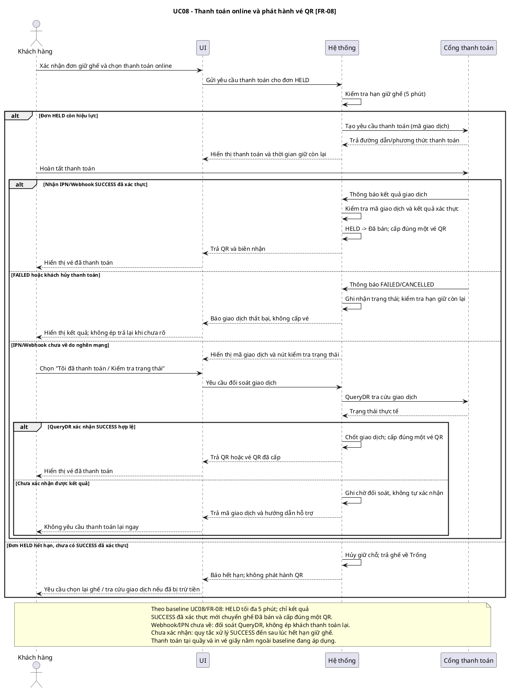

# NHẬT KÝ PROMPT VÀ QUY TRÌNH TINH CHỈNH - BIỂU ĐỒ TUẦN TỰ

> **Tính chất:** Kịch bản tương tác Người dùng – AI được mô phỏng, không phải bản ghi hội thoại lịch sử. Đối chiếu `docs/SRS.md` (bản nội dung GD3) mục UC08, `docs/requirement-analysis/requirement-analysis.md` và `.agents/sequence-diagram/SKILL.md`.

## 📌 BƯỚC 1: PROMPT KHỞI TẠO SKILL

> **User Prompt:**
> "Hãy viết `.agents/sequence-diagram/SKILL.md` cho AI dựng Sequence Diagram bằng PlantUML từ Use Case GD3. Bắt buộc khai báo lifeline Actor, UI, Hệ thống, Phân hệ AI nếu có AI, Cổng thanh toán nếu có thanh toán; dùng `alt ... else ... end` cho luồng chính và luồng phụ, `note over` ghi baseline; kiểm tra nghiệp vụ trước khi phát hành QR và không tự thêm chức năng ngoài phạm vi."

---

## 📌 BƯỚC 2: PROMPT SINH TÀI LIỆU/SƠ ĐỒ (LẦN 1)

> **User Prompt:**
> "Sử dụng `.agents/sequence-diagram/SKILL.md` và mục UC08 trong GD3 (`docs/SRS.md`). Sinh Sequence Diagram cho `UC08_Thanh toán online & phát hành vé QR` [FR-08]: khách thanh toán đơn giữ ghế 5 phút qua cổng thanh toán, hệ thống chỉ phát hành QR sau khi xác nhận giao dịch thành công. Minh họa luồng lỗi IPN/Webhook chưa về."

**Đầu ra lần 1 (mô phỏng):** Chỉ có Khách hàng → UI → Hệ thống → QR, gộp kết quả trả từ cổng thành một bước không kiểm tra trạng thái.

---

## 📌 BƯỚC 3: ĐÁNH GIÁ & PHÁT HIỆN LỖI (AI CHECK)

- ❌ **Điểm chưa ổn 1:** Thiếu lifeline `Cổng thanh toán`; không thể hiện người gửi IPN/Webhook. Với UC08 **không thêm** lifeline `Phân hệ AI` vì Use Case này không gọi AI; nếu dùng UC11 thì lifeline AI mới bắt buộc.
- ❌ **Điểm chưa ổn 2:** Thiếu `alt ... else` cho Webhook/IPN nghẽn mạng, thanh toán thất bại, hết 5 phút và đối soát khi khách đã bị trừ tiền nhưng chưa thấy vé.
- ❌ **Điểm chưa ổn 3:** Thiếu `note over` nêu baseline: chỉ SUCCESS đã xác thực mới phát hành QR; tình trạng giao dịch chưa rõ không được ép khách thanh toán lại hoặc tự phát hành vé.

---

## 📌 BƯỚC 4: PROMPT YÊU CẦU SỬA ĐỔI & BỔ SUNG

> **User Prompt:**
> "Vẽ lại UC08 với lifeline Khách hàng, UI, Hệ thống, Cổng thanh toán theo thứ tự. Phân nhánh `alt ... else` cho SUCCESS đã xác thực, FAILED/CANCELLED, và IPN/Webhook bị nghẽn: ở trường hợp chưa rõ, khách chọn kiểm tra trạng thái để hệ thống hỏi Cổng thanh toán (QueryDR), chỉ cấp đúng một QR nếu được xác nhận SUCCESS; nếu vẫn chưa rõ thì giữ trạng thái chờ đối soát, không yêu cầu trả tiền lại. Xử lý đơn HELD hết 5 phút khi chưa có xác nhận, thêm `note over` giải thích baseline và kết quả đến trễ chưa chốt. Không thêm Phân hệ AI cho UC08, vì đây không phải use case AI."

---

## 📌 BƯỚC 5: KẾT QUẢ CHỐT CUỐI CÙNG (FINAL OUTPUT)

**UC08 / FR-08 — Sequence Diagram (PlantUML):**

**Điểm chốt:** Cổng thanh toán là lifeline liên quan, AI không có mặt trong UC08; lỗi nghẽn Webhook/IPN dẫn tới đối soát thay vì tự phát hành vé.
